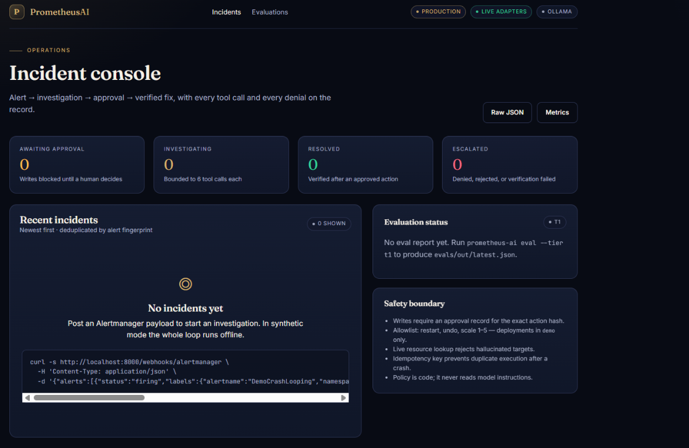
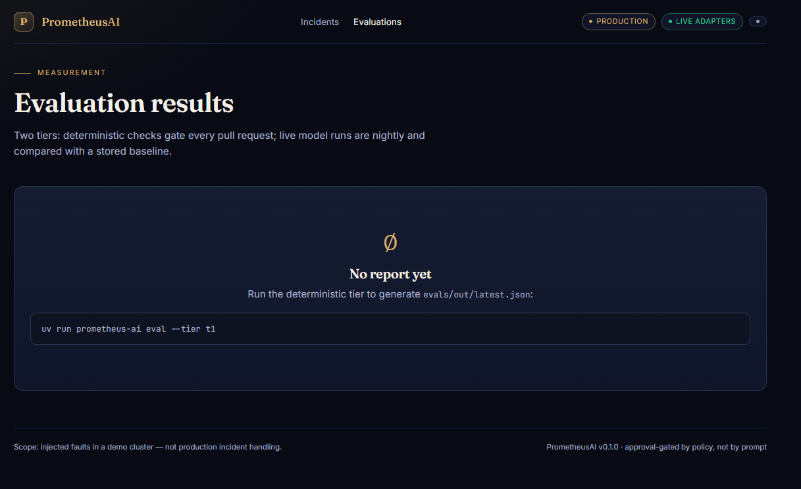

# PrometheusAI

**Approval-gated incident response for Kubernetes.**

PrometheusAI investigates an alert, gathers evidence, proposes a bounded
remediation, and performs a server-side dry run. A human must approve the exact
action before a separate policy service can execute it. The system records
decisions and verifies the outcome.

> **Scope:** This repository is a working demo for injected faults in a local
> kind cluster. It has not been validated on real production incidents and
> should not be treated as a production-ready autonomous operator.

## At a glance

- **Human approval before writes.** Approval is bound to the proposal's
  SHA-256 action hash and expires.
- **Policy separated from the agent.** The policy service owns the Kubernetes
  write identity; the agent has read-only RBAC.
- **Narrow remediation surface.** Only allowlisted restart, undo, and scale
  operations on named demo deployments are supported.
- **Fail closed.** Invalid actions, failed dry runs, missing approvals, and
  policy denials do not proceed to execution.
- **Auditable and testable.** Decisions, execution results, and evaluation
  reports have explicit storage and test coverage.

## Screenshots

The console shows incident status and the safety boundary. This captured view
is the empty state, before any incidents were submitted.



The evaluation page shows where deterministic evaluation results appear. In
this captured view, no report had been generated yet.



## How an incident flows

```text
Alertmanager
    -> agent investigates with observability and read-only cluster tools
    -> proposes an allowlisted action
    -> server-side dry run
    -> human approval bound to the action hash
    -> policy service authorizes and executes once
    -> verification and postmortem
```

The agent can use a deterministic fake model, Ollama, or Bedrock. Model output
does not grant authority: the policy engine enforces the action, target,
namespace, bounds, approval, and write limits.

## Quickstart: synthetic local demo

Requires Python 3.12+ and [uv](https://docs.astral.sh/uv/).

```powershell
git clone https://github.com/coderv1304/PrometheusAI.git
cd PrometheusAI
uv sync --extra dev --extra graph --extra postgres
$env:PROMETHEUS_AI_MODEL_BACKEND = "fake"
uv run prometheus-ai demo --host 127.0.0.1 --port 8000
```

Open <http://127.0.0.1:8000>. The demo prints synthetic incident IDs and the
development approval token. In another terminal, while the demo server is still
running, approve an ID printed by that run:

```powershell
uv run prometheus-ai approve INCIDENT_ID `
  --approver operator `
  --reason "restart is the narrowest safe action" `
  --token dev-approval-token
```

Replace `INCIDENT_ID` with the current run's ID; in-memory demo incidents do
not persist across restarts. The development token is for local synthetic
mode only. Never use it outside a development environment.

## Verification

### Tests passed

The latest local full-suite run reported:

> **PASS — 67 tests passed** with `uv run pytest` (4.61 seconds).

It also emitted 208 `pytest-asyncio` deprecation warnings concerning event-loop
policy APIs; these were warnings, not test failures. This is a local test
result, not a claim that the GitHub Actions workflow has run or passed.

Run the suite and lint locally:

```powershell
uv run pytest
uv run ruff check src tests scripts
```

Tests are organized around:

| Area | Tests |
| --- | --- |
| API auth and security headers | [`tests/test_api_security.py`](tests/test_api_security.py) |
| Agent graph approval and no-write guarantees | [`tests/test_graph_security.py`](tests/test_graph_security.py) |
| Policy decisions and action bounds | [`tests/test_policy.py`](tests/test_policy.py) |
| Kubernetes manifest invariants | [`tests/test_manifests.py`](tests/test_manifests.py) |
| Configuration and production defaults | [`tests/test_config.py`](tests/test_config.py) |
| Secret redaction | [`tests/test_redaction.py`](tests/test_redaction.py) |
| CLI demo lifecycle | [`tests/test_cli.py`](tests/test_cli.py) |
| PostgreSQL / pgvector schema | [`tests/test_postgres_schema.py`](tests/test_postgres_schema.py) |

### Deterministic evaluation

Run the T1 evaluation harness:

```powershell
uv run prometheus-ai eval --tier t1 --verbose
```

The committed baseline covers 13 hand-authored scenarios. Its recorded
deterministic results are 100% root-cause, action, tool-call, and status
accuracy, with a 0% unsafe-action rate. These are harness results, **not live
model accuracy or production incident metrics**. See
[`docs/EVALUATION.md`](docs/EVALUATION.md) for methodology and limitations.

## Architecture and implementation map

| Component | Purpose | Implementation |
| --- | --- | --- |
| HTTP API and UI | Webhooks, incident views, approvals, admin endpoints | [`src/prometheus_ai/api/app.py`](src/prometheus_ai/api/app.py), [`src/prometheus_ai/api/templates/`](src/prometheus_ai/api/templates/) |
| Agent workflow | Investigation graph, evidence gathering, proposal, verification | [`src/prometheus_ai/agent/graph.py`](src/prometheus_ai/agent/graph.py), [`src/prometheus_ai/agent/nodes.py`](src/prometheus_ai/agent/nodes.py) |
| Policy engine | Deterministic authorization and kill switch | [`src/prometheus_ai/policy/engine.py`](src/prometheus_ai/policy/engine.py), [`src/prometheus_ai/policy/rules.py`](src/prometheus_ai/policy/rules.py) |
| Policy API and executor | Authenticated policy endpoint and Kubernetes writes | [`src/prometheus_ai/policy/server.py`](src/prometheus_ai/policy/server.py), [`src/prometheus_ai/policy/executor.py`](src/prometheus_ai/policy/executor.py) |
| Kubernetes inventory | Live, read-only resource lookup | [`src/prometheus_ai/policy/inventory.py`](src/prometheus_ai/policy/inventory.py) |
| Observability tools | Prometheus, Loki, Kubernetes reads, runbooks | [`src/prometheus_ai/tools/`](src/prometheus_ai/tools/) |
| Model adapters and redaction | Fake/Ollama/Bedrock adapters and prompt-data redaction | [`src/prometheus_ai/llm/client.py`](src/prometheus_ai/llm/client.py), [`src/prometheus_ai/llm/redact.py`](src/prometheus_ai/llm/redact.py) |
| Persistence | Incident, audit, and Postgres schema | [`src/prometheus_ai/storage/postgres.py`](src/prometheus_ai/storage/postgres.py), [`src/prometheus_ai/storage/base.py`](src/prometheus_ai/storage/base.py) |
| Runtime composition | Builds the agent and policy service dependencies | [`src/prometheus_ai/services/bootstrap.py`](src/prometheus_ai/services/bootstrap.py) |
| CLI | Demo, serving, evaluation, approval, and operations commands | [`src/prometheus_ai/cli.py`](src/prometheus_ai/cli.py) |

For the request sequence and component diagram, see
[`docs/architecture.md`](docs/architecture.md).

## Kubernetes deployment

Deployment is deliberately documented as an ordered procedure, including
cluster prerequisites, secrets, custom pgvector image build/load, RBAC,
NetworkPolicy probes, and verification:

- **[Deployment guide](docs/DEPLOYMENT.md)**
- [Kustomize base resources](deploy/k8s/base/kustomization.yaml)
- [RBAC and ServiceAccounts](deploy/k8s/base/01-serviceaccounts-rbac.yaml)
- [NetworkPolicies](deploy/k8s/base/02-networkpolicies.yaml)
- [PostgreSQL / pgvector workload](deploy/k8s/base/03-postgres.yaml)
- [Policy service workload](deploy/k8s/base/04-policy-service.yaml)
- [Agent workload](deploy/k8s/base/05-agent.yaml)
- [Demo workloads](deploy/k8s/base/06-demo-app.yaml)
- [PostgreSQL image build](deploy/postgres/Dockerfile)
- [Demo fault injection](demo/fault.sh)

Do not delete the database PVC when troubleshooting. Keep credentials out of
source control; use the example secret manifest only as a template:
[`deploy/k8s/base/secrets.example.yaml`](deploy/k8s/base/secrets.example.yaml).

## CI and supply chain

- [CI workflow](.github/workflows/ci.yml) runs Ruff, pytest, the T1 gate,
  version-report smoke test, container builds/smoke test, and manifest
  rendering/schema validation.
- [Security workflow](.github/workflows/security.yml) contains secret and
  image security checks, SBOM generation, and keyless image signing.
- [Dependabot configuration](.github/dependabot.yml).

Workflow definitions describe configured checks; they do not prove a specific
run has passed. Check the Actions tab for the result of your commit.
Cosign verification requires a successfully signed image and its exact digest.

## Security and design documentation

- [Security controls and verification](docs/SECURITY.md)
- [Threat model and residual risks](docs/THREAT_MODEL.md)
- [Architecture](docs/architecture.md)
- [Evaluation methodology](docs/EVALUATION.md)
- [Architecture decision records](docs/adr/)
- [Operational runbooks](docs/runbooks/)
- [Generated dependency versions](docs/VERSIONS.md)
- [Environment variable template](.env.example)
- [Project dependencies and commands](pyproject.toml)

## Known limitations

- The supported deployment is a small kind demonstration, not a production
  high-availability setup.
- The example cluster uses static shared tokens rather than workload identity.
- Secret redaction is pattern-based and cannot guarantee detection of every
  sensitive format.
- The execution idempotency ledger is SQLite on an `emptyDir` and does not
  survive pod replacement.
- T1 is a small deterministic harness; live-model quality is not measured.
- The demo fault injector intentionally changes only the demo application's
  fault mode; it is separate from the agent's remediation API.
